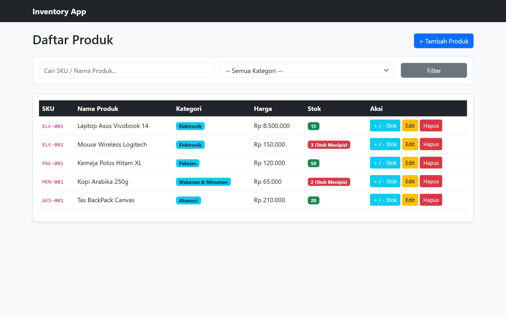
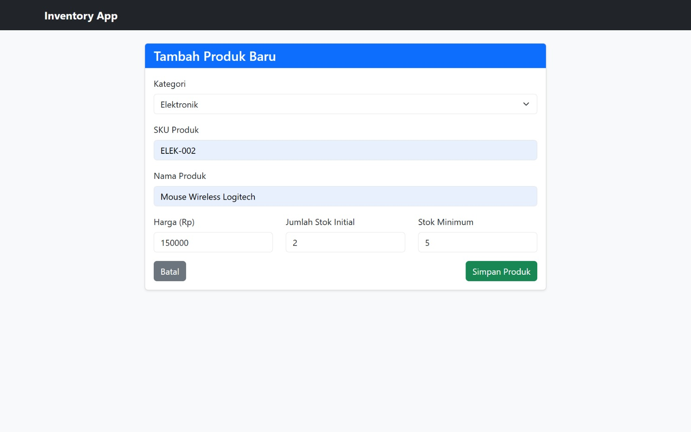
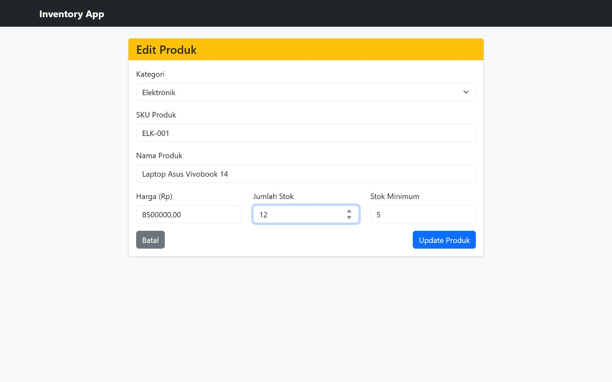
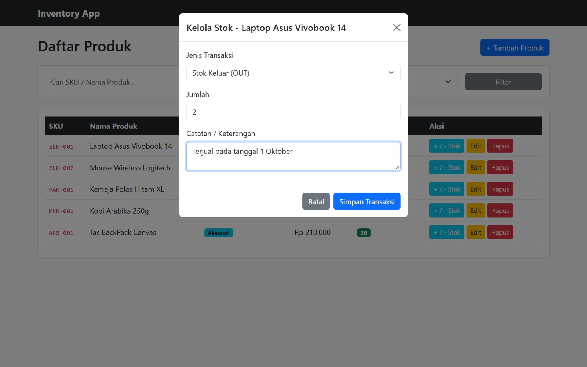
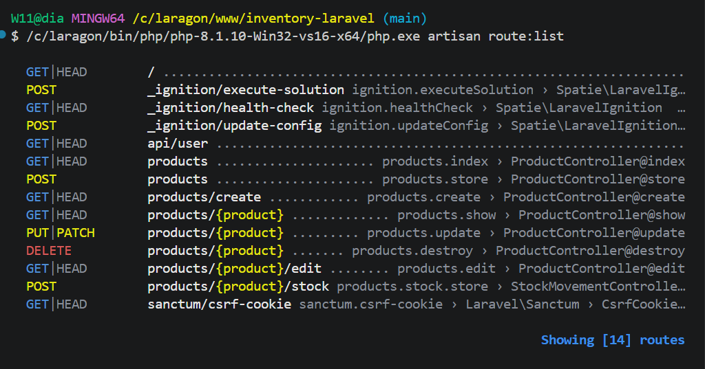

# Laporan Tugas Pertemuan 5: Migrasi Inventory Management System ke Laravel v10

## 1. Deskripsi Project
Project ini merupakan migrasi aplikasi Inventory Management System dari PHP Native ke framework Laravel v10. Migrasi ini menerapkan arsitektur MVC (Model-View-Controller) dengan fitur utama:
- Manajemen data produk (CRUD).
- Filter kategori dan pencarian data berbasis AJAX/Query berdasarkan SKU atau Nama Produk.
- Pencatatan mutasi stok barang masuk (IN) dan barang keluar (OUT).
- Peringatan indikator stok menipis (minimum stock alert).

---

## 2. Arsitektur MVC & Alur Kerja Project
1. **Route (`routes/web.php`)**: Menerima HTTP Request dari browser dan mengarahkannya ke Controller yang sesuai.
2. **Controller (`app/Http/Controllers/`)**:
   - `ProductController`: Mengelola logika bisnis CRUD produk, validasi input, serta filter/pencarian.
   - `StockMovementController`: Mengelola transaksi pergerakan stok (IN/OUT) serta memperbarui jumlah stok produk secara otomatis.
3. **Model & Database (`app/Models/`)**:
   - `Product`, `Category`, `StockMovement`: Menggunakan Eloquent ORM untuk berinteraksi dengan database MySQL `inventory_db`.
4. **View (`resources/views/`)**:
   - Menggunakan Blade Engine dan Bootstrap 5 untuk menyajikan antarmuka pengguna (`index.blade.php`, `create.blade.php`, `edit.blade.php`, `layouts/app.blade.php`).

---

## 3. Alur Fitur (Form -> Validasi -> Simpan -> Redirect -> Tampil Data)
1. **Membuka Form**: Pengguna menekan tombol `+ Tambah Produk` untuk membuka halaman `products/create`.
2. **Validasi**: Input diperiksa di `ProductController::store()` (memastikan kategori ada, SKU unik, harga/stok bernilai positif).
3. **Simpan**: Setelah lolos validasi, data disimpan ke tabel `products` menggunakan Eloquent `Product::create()`.
4. **Redirect & Tampil Data**: Pengguna diarahkan kembali ke `products.index` disertai pesan sukses, dan data baru langsung muncul di tabel utama.

---

## 4. Antarmuka dan Penjelasan Fitur Utama

### 1. Dashboard & Katalog Utama


**Penjelasan Fitur:**
- **Tabel Katalog Produk**: Menampilkan seluruh daftar inventaris barang yang mencakup kolom SKU, Nama Produk, Kategori, Harga, dan Jumlah Stok.
- **Badge Indikator Stok**: Penanda visual stok barang. Angka stok akan diberi penanda khusus jika stok berada di bawah atau sama dengan batas minimum stok.
- **Pencarian & Filter**: Memudahkan pencarian produk secara fleksibel berdasarkan SKU, Nama Produk, atau Kategori.
- **Tombol Aksi**: Akses cepat menuju form Edit, Hapus, dan Modal Kelola Stok langsung dari baris tabel.

---

### 2. Form Tambah Produk Baru


**Penjelasan Fitur:**
- **Input Data Terstruktur**: Form terstandarisasi untuk menambah item inventaris baru.
- **Validasi Server-side**: Menjamin integritas data seperti keunikan kode SKU, harga bernilai positif, serta memastikan kategori valid.
- **Dropdown Relasional**: Pilihan kategori yang terhubung dinamis dengan tabel kategori di database melalui Eloquent.

---

### 3. Form Perbarui Data (Edit Produk)


**Penjelasan Fitur:**
- **Auto-fill Data**: Menampilkan data lama produk secara otomatis ke dalam bidang input untuk memudahkan pengguna memperbarui informasi.
- **Update Dinamis**: Memperbarui record produk tanpa merusak relasi data transaksi stok yang sudah tercatat sebelumnya.

---

### 4. Pop-up Modal Kelola Stok (IN / OUT)


**Penjelasan Fitur:**
- **Form Mutasi Fast-Access**: Membuka antarmuka modal tanpa perlu berpindah halaman untuk mencatat mutasi barang masuk (IN) atau barang keluar (OUT).
- **Otomatisasi Stok**: Mengkalkulasi dan memperbarui saldo stok akhir di tabel produk secara otomatis tepat setelah transaksi disimpan.
- **Catatan Transaksi**: Menyediakan kolom keterangan untuk mencatat alasan atau riwayat penyebab perubahan stok.

---

### 5. Terminal Route List Laravel


**Penjelasan Fitur:**
- **Pemetaan RESTful Route**: Menampilkan seluruh pendaftaran URL endpoint beserta HTTP Method (`GET`, `POST`, `PUT/PATCH`, `DELETE`) dan Controller pembimbingnya.

---

## 5. Tutorial Penggunaan Aplikasi

### 1. Mengakses Halaman Utama
- Jalankan server lokal (`php artisan serve`), lalu buka tautan di browser.
- Anda akan langsung disajikan halaman daftar produk beserta pencarian dan filter data.

### 2. Mengolah Data Produk
- Klik tombol **+ Tambah Produk** untuk menginputkan item baru.
- Gunakan tombol **Edit** berwarna kuning di samping baris produk jika ingin mengubah informasi harga atau nama produk.
- Klik tombol **Hapus** berwarna merah untuk menghapus record dari basis data.

### 3. Transaksi Mutasi Stok
- Klik tombol **+ / - Stok** di baris produk yang diinginkan.
- Pilih Tipe Transaksi (**Stok Masuk / IN** atau **Stok Keluar / OUT**), masukkan jumlah unit, beserta catatan ringkas.
- Tekan **Simpan Transaksi**, stok akan otomatis bertambah/berkurang di halaman utama.

---

## 6. Spesifikasi Teknologi

- **Framework**: Laravel v10
- **Bahasa Pemrograman**: PHP >= 8.1
- **Database / ORM**: MySQL / Eloquent ORM
- **Template Engine**: Laravel Blade & Bootstrap 5
- **Arsitektur**: Model-View-Controller (MVC)

---

## 7. Instruksi Instalasi & Cara Menjalankan

### Persyaratan Sistem
- PHP >= 8.1
- Composer
- Laragon / XAMPP (MySQL)

### Langkah-Langkah Instalasi
1. Clone Repository:
   ```bash
   git clone [https://github.com/Arstaaw1/inventory-laravel.git](https://github.com/Arstaaw1/inventory-laravel.git)
   cd inventory-laravel